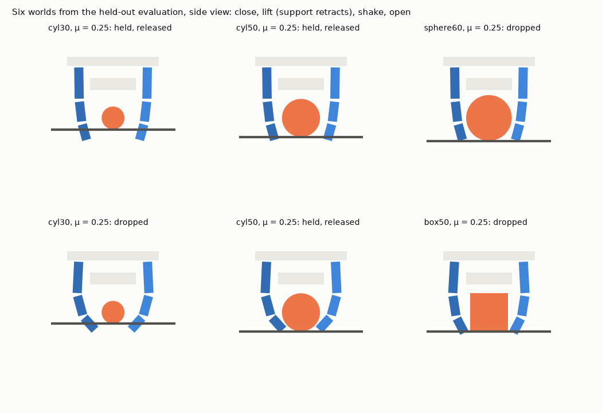
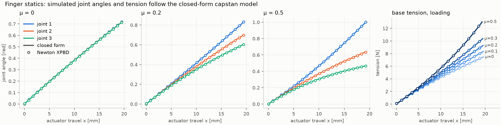
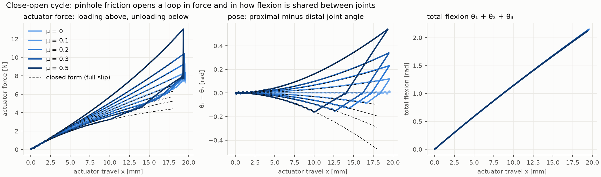
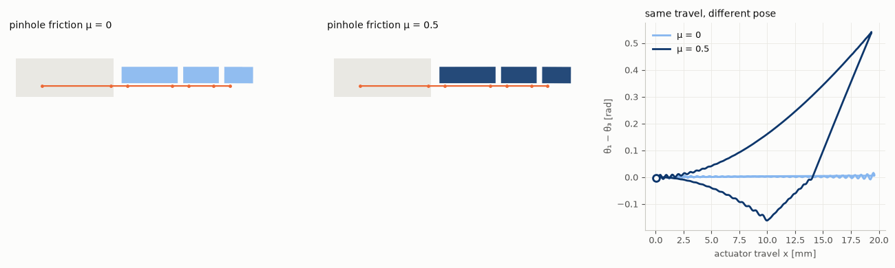
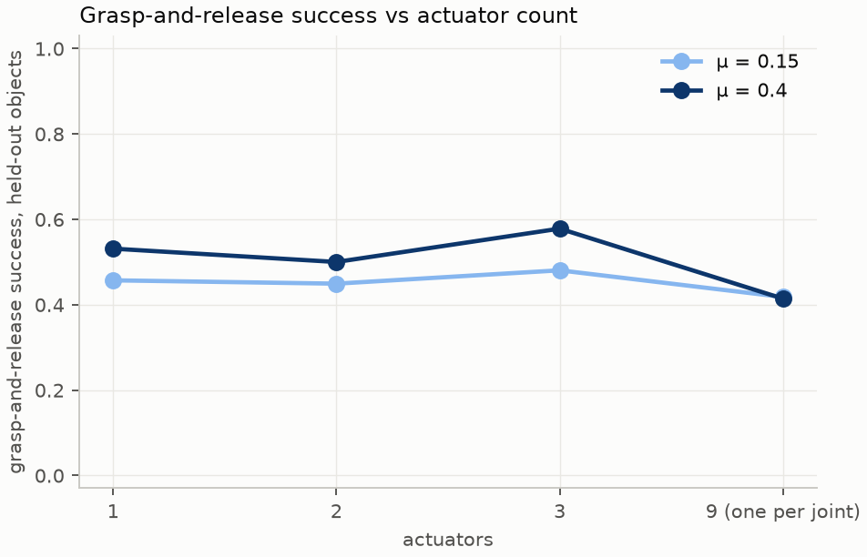
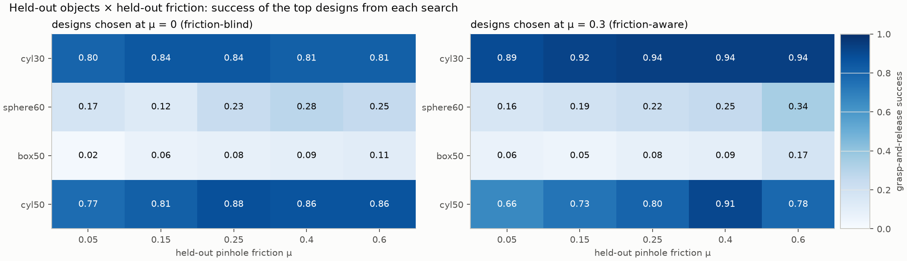
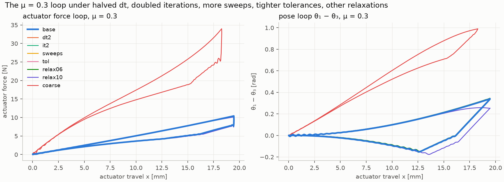

# DeXdon

**What tendon friction does to an underactuated robot hand, measured on the massless routed tendons that shipped in Newton 1.8.**

A 3-joint finger driven by one tendon is validated against closed-form capstan statics,
then three of them become a hand that is tested in thousands of parallel worlds.
Every number below is in [docs/results.md](docs/results.md) with the command that
reproduces it. The derivations, with worked examples, are in
[docs/derivations.md](docs/derivations.md).

Setup in one paragraph: Newton `main @ 7ee5484`, Warp 1.19, `SolverXPBD`. Each finger has
three phalanges (45 / 30 / 25 mm), a torsion return spring at each joint, and one tendon
anchored on a prismatic slider, threaded through two `PINHOLE` guides per joint and anchored
on the distal phalanx. Friction `μ` is set only on the pinholes. The slider is driven to a
position target.

## Three results that held

### The simulated finger matches closed-form mechanics

With `d = √(a² + h²)` and `φ = atan2(h, a)`, the tendon span crossing a joint has moment arm
`r(θ) = d sin(φ + θ/2)`, each pinhole bends the tendon by `θ/2`, and tension changes by
`e^(∓μθ/2)` per pinhole. Statics: `k(θ − θ0) = T r(θ)`.

Across `μ ∈ {0, 0.1, 0.2, 0.3, 0.5}` and joint angles up to 1.01 rad:

- joint angles within **0.0035 rad (0.20°)** of the closed form, RMS 0.0014–0.0017 rad;
- base tension, read independently from the actuator servo, within 1.2–1.3 % RMS (0.7 %
  maximum beyond 5 mm of travel);
- tension ratio across each individual pinhole within 0.0008 of `e^(−μθ/2)`.

Run the other way, the model identifies the finger: from one close-open cycle with 0.5° of
angle noise, a `wp.Tape` gradient fit of the closed form recovers μ within 1.51 % and k within
0.31 % on five held-out pairs, and a brute-force search over 4,096 simulated worlds recovers
them within 0.41 % and 0.11 %
([details](docs/results.md#recovering-friction-and-stiffness-from-a-trajectory)).

### Friction opens a loop in force and in pose, while tendon length pins total flexion

| μ | energy lost per cycle [mJ] | force gap [N] | largest joint-angle gap [rad] | fingertip gap [mm] | total-flexion gap [rad] |
|---|---|---|---|---|---|
| 0 | −0.65 | 0.07 | 0.005 | 0.32 | 0.0002 |
| 0.1 | 9.55 | 1.19 | 0.088 | 6.22 | 0.0015 |
| 0.2 | 18.55 | 2.12 | 0.131 | 9.41 | 0.0030 |
| 0.3 | 27.04 | 2.92 | 0.173 | 11.05 | 0.0044 |
| 0.5 | 43.88 | 4.63 | 0.223 | 12.00 | 0.0073 |

At the same actuator travel the fingertip sits up to 12 mm apart between closing and opening
and the actuator force differs by up to 4.63 N. Total flexion is the same on both branches
to within 0.0073 rad, because the tendon's length fixes the sum of the joint angles.
Friction changes how flexion is shared: distal joints lag while closing and lead while
opening. Both branches follow the closed form (loading within 0.0035 rad; unloading, after
the turnaround transition, within 0.0029 rad).

### No detectable difference between 1 and 3 actuators

A hand of two fingers and a thumb closes on an object, the support retracts, the palm is
shaken at 15 m/s² and 3 Hz, and the hand opens. 384 random designs were searched for one
shared actuator and 256 each for two actuators, three actuators and a per-joint baseline;
the top 32 of each were tested on four held-out objects (256 worlds per point).
Grasp-and-release success:

| solver setting | 1 actuator | 2 | 3 | 9, one per joint (no tendon) |
|---|---|---|---|---|
| baseline | 0.494 | 0.475 | 0.529 | 0.416 |
| 2× iterations | 0.516 | 0.541 | 0.582 | 0.414 |
| dt / 2 | 0.559 | 0.572 | 0.598 | 0.400 |
| consistent joint rows (see below) | 0.496 | 0.469 | 0.531 | 0.408 |

- 3 actuators minus 1: +0.035 [−0.053, +0.121] at baseline and +0.035 [−0.045, +0.117]
  with consistent joint rows. There is no detectable difference between 1 and 3 actuators in any of
  the four settings.
- 1 actuator minus per-joint: +0.078 [+0.010, +0.146] at baseline, +0.088 [+0.016, +0.156]
  with consistent joint rows. The interval excludes zero in all four settings.

The per-joint baseline is nine torque-limited joint servos with open-loop targets found by
the same random-search budget. So the claim is narrow: under open-loop commands the
underactuated tendon hand is easier to command than nine independent joints, and going
from one actuator to three made no detectable difference in this test.

All hand batches in this README have **0 invalid worlds** (4,608 in the search, 4,612 in
each evaluation) and 0 tendon ERROR diagnostics.

## A null result: designing for friction did not help

Hypothesis: designs chosen assuming a frictionless tendon lose performance under real
friction, and designs chosen with friction are more robust. The 384 single-actuator designs
were ranked at μ = 0 and again at μ = 0.3; the top 32 of each ranking were tested on four
held-out objects, five held-out friction values and two object offsets (1,280 worlds each).

| solver setting | chosen at μ = 0 | chosen at μ = 0.3 | difference, 95 % bootstrap over designs |
|---|---|---|---|
| baseline | 0.485 | 0.505 | +0.020 [−0.055, +0.098] |
| 2× iterations | 0.521 | 0.523 | +0.002 [−0.095, +0.102] |
| dt / 2 | 0.559 | 0.573 | +0.014 [−0.080, +0.111] |
| consistent joint rows | 0.487 | 0.497 | +0.010 [−0.066, +0.090] |

**The hypothesis is not supported.** The difference never separates from zero, and the two
top-32 sets share 20 designs. Success does rise with pinhole friction in every setting
(+0.03 to +0.10 from μ ≤ 0.15 to μ ≥ 0.4), but the interval excludes zero in only two of
the four settings, so that stays a suggestion. Both populations hold the cylinders
(0.66–0.94) and mostly fail the 60 mm sphere and the 50 mm box.

## What I ran into in the solver

Two XPBD problems got in the way before any result was trustworthy. Both turned out to be
already reported by [pulipakaa24](https://github.com/pulipakaa24), who also has fixes open;
my part is an independent reproduction and a measurement of what they do to a task.

- **Joint drive stiffness depends on the iteration count**
  ([newton#4315](https://github.com/newton-physics/newton/issues/4315), draft fix in
  [#4318](https://github.com/newton-physics/newton/pull/4318)). A `target_ke` drive came
  out at 0.41× / 0.87× / 1.59× / 3.18× / 5.00× the requested stiffness at 1 / 2 / 4 / 8 / 16
  iterations. The return springs and the actuator servo here are explicit forces instead.
- **Positional joint rows use two relaxation factors for one impulse**
  ([newton#4314](https://github.com/newton-physics/newton/issues/4314), fix in
  [#4317](https://github.com/newton-physics/newton/pull/4317)). With the defaults (linear
  0.7, angular 0.4) a hinged rod's period is 9.0 % long at any iteration count, and the
  tendon finger's joint angles are off by 0.0734 rad and its base tension by 16.0 %.

What this adds to those reports: **the relaxation bug changes whether a hand holds an
object.** On the same 1,568 hand worlds, 0.906 of objects are still held after the shake on
unmodified `main` and 0.630 once both parts of a positional row use the linear factor. I
also compared that choice with using the angular factor for both parts: the linear factor
passes Newton's 1,228 selected XPBD, joint, tendon and pendulum tests, the angular factor
fails two of them.

One more observation, which matches the note in #4317 about lowering the default factor:
with one common factor for both parts, 60.78 % of 1,568 hand worlds became invalid at 0.8,
0.13 % at 0.7 and none at 0.6 or below. A per-substep recorder shows a finger link breaks
first in all 953 cases. Halving dt (61.80 %), colliding every substep (61.35 %) and
delivering the actuator force through `joint_f` (60.40 %) do not change it. Several rows act
on one phalanx's rotation and their corrections add.

I also tried to reproduce newton#5596 in pure Newton: non-reset worlds stayed within
1.2e-6 m of the reference, against 4.2e-3 m in the report (caveat in docs/results.md).

## Validation and sensitivity

**Single finger.** The μ = 0.3 loop under each numerical change:

| change | loop work vs baseline | largest joint-angle change [rad] |
|---|---|---|
| dt halved | +1.6 % | 0.0024 |
| iterations doubled | −0.2 % | 0.0018 |
| `tendon_max_sweeps` 256 → 1024 | +0.0 % | 0.0001 |
| `tendon_settle_tol` 1e-3 → 1e-4, `atol` 1e-6 → 1e-7 | −0.7 % | 0.0014 |
| joint relaxation 0.8 → 0.6 | +0.3 % | 0.0060 |
| joint relaxation 0.8 → 1.0 | +3.1 % | 0.0463 |

Relaxation 1.0 is the outlier (0.0483 rad off the closed form).
At the 16 substeps × 8 iterations of Newton's tendon examples this finger is not converged
(loop work 1.9× the converged value), so everything here runs at 64 × 32.

**Hand.** The evaluation was run four times on the same selected designs: baseline, doubled
iterations, halved dt, and on Newton with consistent joint rows (the change proposed in
newton#4317) at its default factors.
`*` marks intervals that exclude zero.

| comparison | baseline | 2× iterations | dt / 2 | consistent joint rows |
|---|---|---|---|---|
| friction-aware − friction-blind | +0.020 | +0.002 | +0.014 | +0.010 |
| 3 actuators − 1 actuator | +0.035 | +0.066 | +0.039 | +0.035 |
| 1 actuator − per-joint | +0.078 * | +0.102 * | +0.158 * | +0.088 * |
| 3 actuators − per-joint | +0.113 * | +0.168 * | +0.197 * | +0.123 * |

Every comparison keeps its sign in every setting. Absolute success moves by up to 0.074
between settings, so the levels are less certain than the comparisons.

**Negative controls.**

- μ = 0: loop work −0.65 mJ (2.4 % of the μ = 0.3 loop), shrinking to −0.13 mJ at dt/2.
- Tendon detached, single finger: the slider travels 19.98 mm and no joint moves (0.0 rad).
- Tendons detached, hand: 0 of 4 held-out objects held, in each of the four settings.

**How invalid worlds are handled.** A world is invalid if anything is non-finite, a hand
body exceeds 10 m/s or 500 rad/s, tension exceeds 150 N, or a tendon ERROR is printed. A
kernel that runs after every substep, inside the captured CUDA graph, records the first
failure per world. Invalid worlds count as failures and stay in the denominator. The first
hand runs lost 28–56 % of worlds this way; they were traced to the summed-relaxation effect above and rerun,
not filtered.

## Limitations

- XPBD only. VBD was not run.
- The finger study is quasi-static, gravity off, one finger geometry. The closed form
  covers the full-slip branches; the stick-slip transition after the turnaround is
  simulated but not modeled analytically.
- The hand study is open-loop: one fixed closing command per design, no sensing. Objects
  are light (35–90 g); heavier ones were not run. Random search only, 384 and 256 designs.
- The hand runs at joint relaxation 0.6, where the single-finger closed-form error is
  0.0082 rad instead of 0.0035 rad.
- The per-joint baseline is a torque-limited joint servo with open-loop targets, not a
  tendon-per-joint hand.
- A shared actuator is modeled as equal displacement commands to identical per-finger
  sliders, each with the same 15 N force limit.
- Friction values are a sweep. A measured range for tendon–eyelet pairs is not sourced yet.
- Pinholes are points. Real eyelets have radius and real tendons have bending stiffness.
- Newton's tests for the solver fix were run on macOS CPU only.
- No hardware comparison yet.

## Next steps

- **A physical finger.** 3D-print this finger, drive it with a servo and fishing line, and
  film its measured hysteresis loop next to the simulated one. Its geometry and spring
  constants are the ones already in `dexdon/finger.py`.
- Propose an adaptive-finger tendon example for Newton with analytic regression tests.
- Closed-loop grasping and heavier objects on the now-stable hand harness.

---

Reproduce: setup and every command are in [docs/results.md](docs/results.md). Layout: `dexdon/`
(finger, closed form, hand harness, system identification), `experiments/` (runs, analysis,
clips), `scripts/sysid.py`, `tests/`, `upstream/` (repro and measurement scripts), `docs/`,
`results/`, `figures/`, `clips/`.
